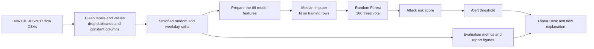

# CyberSift – Filtering Network Noise, Finding Threats

CyberSift is an AI2002 Path A software project. It scores network flow summaries with a saved Random Forest model, ranks suspicious flows, and gives analysts simple explanations and review tools.

## Problem

Security teams cannot inspect every network connection by hand. CyberSift turns each flow into a risk score from 0 to 1 and raises an alert when that score reaches the selected threshold. The app accepts the included demo sample or a CSV upload.

## Dataset

The project uses CIC-IDS2017 CSV flow records from the Canadian Institute for Cybersecurity at the University of New Brunswick. The dataset contains labeled benign and attack traffic collected over five weekdays in a lab environment. Download the official `MachineLearningCSV.zip` from the [CIC-IDS2017 dataset page](https://www.unb.ca/cic/datasets/ids-2017.html). Extract its weekday CSV files directly into `data/raw/`; the filenames must include Monday, Tuesday, Wednesday, Thursday, or Friday.

Raw and processed datasets are local-only. The app uses the small committed demo sample, the saved Random Forest, and saved reports; it does not need the raw CIC-IDS2017 files to run.

## Architecture



The saved pipeline performs imputation and classification together. Training and inference use the same `prepare_features()` function and feature order.

## Reproduce the project

Run these commands from the repository root. The current training environment uses Python 3.13.14; use Python 3.13 for the closest match and a virtual environment.

1. Create and activate an environment (Windows PowerShell shown):

   ```powershell
   python -m venv .venv
   .\.venv\Scripts\Activate.ps1
   ```

2. Install runtime and development packages:

   ```powershell
   python -m pip install -r requirements.txt
   python -m pip install -r requirements-dev.txt
   ```

3. Download and extract the CIC-IDS2017 `MachineLearningCSV.zip` as described above. Put the weekday CSV files directly in `data/raw/`.

4. Clean the raw data and create the saved demo sample, feature list, split assignments, and rules thresholds:

   ```powershell
   python scripts/prepare_data.py
   python scripts/make_sample.py
   ```

5. Generate the exploratory figures and tables:

   ```powershell
   python scripts/eda.py
   ```

6. Train the models and evaluate on the untouched test split:

   ```powershell
   python scripts/train_models.py
   python scripts/evaluate.py
   ```

7. Run the tests and save their evidence:

   ```powershell
   python scripts/run_tests_with_evidence.py
   ```

   The verbose log is saved to `reports/test_log.txt`; the case summary is saved to `reports/tables/test_cases.csv`.

## Run the app

```powershell
streamlit run app.py
```

The app uses the repository-relative paths declared in `src/cybersift/config.py`. It requires `models/cybersift_rf.joblib` and `data/sample/cybersift_demo.csv`; report-card views read saved files from `reports/`. If the model or demo sample is missing, the app displays a clear error.

### Streamlit Community Cloud

Create a Community Cloud app pointing to this repository and set the main file path to `app.py`. In Advanced settings, select Python 3.13 to match the training environment. Cloud installs the pinned runtime packages from `requirements.txt`. Keep `models/cybersift_rf.joblib`, `data/sample/cybersift_demo.csv`, and the `reports/` directory in the deployed repository. The raw and processed CIC-IDS2017 data are not required by the running app.

Live app: **[Add Streamlit Community Cloud URL after deployment]**

## Test results

The table below is from `reports/metrics.json`, under `random_test.models`. Values are for the untouched random test split.

| Model | Precision | Recall | F1 | PR-AUC |
|---|---:|---:|---:|---:|
| Rules | 0.7989 | 0.7083 | 0.7509 | 0.6143 |
| Logistic Regression | 0.8381 | 0.9318 | 0.8825 | 0.9427 |
| Decision Tree | 0.9894 | 0.9895 | 0.9895 | 0.9936 |
| Random Forest | **0.9949** | **0.9981** | **0.9965** | **0.9998** |

The separate Friday day-shift evaluation reports Random Forest recall of 0.3677 and PR-AUC of 0.7413. This shows that high random-split performance does not guarantee detection when traffic patterns shift.

## Limitations

- CIC-IDS2017 is 2017 lab data with simulated attack traffic; results may not reflect current production networks.
- The dataset has known label quality issues, and some attack types are very rare.
- The model uses flow summaries and does not inspect packet payloads.
- The Friday day-shift result shows a substantial generalization gap for attack styles that differ from training.
- Traffic and attack behavior change, so the model needs monitoring and retraining over time.

## Team and course

- Team: **[Add team member names]**
- Course: **AI2002 · Path A: Software (ML + Streamlit)**
